

  

## About

I'm a Computer Science student and AI Application Developer from Lahore. I build AI-powered apps, automation tools, and web projects. I use AI to move fast, then test, review, and improve the results myself.

I'm in the final semester of my Associate Degree in Computer Science at Lahore Leads University, and I keep building while I grow my programming and AI skills.

  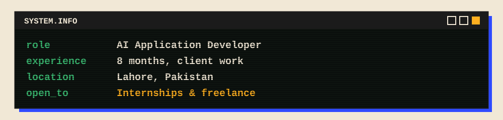

## What I build

  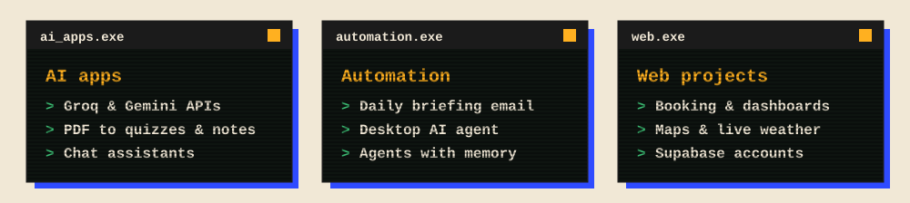

## Tech Stack

  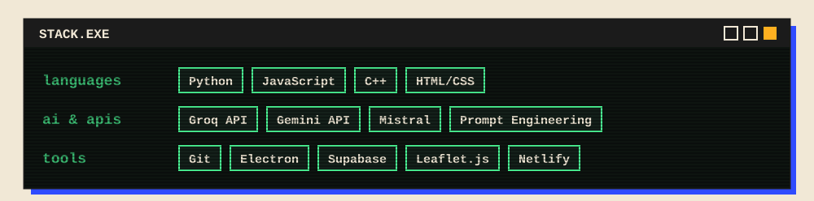

## Featured Work

Client projects are live. Personal builds are still in progress.

  <a href="https://pak-explorer.netlify.app"></a>
  <a href="https://the-auto-quiz.netlify.app"></a>
  <a href="https://the-smart-notes.netlify.app"></a>
  <a href="https://the-primecart.netlify.app"></a>
  
  

## Contact

  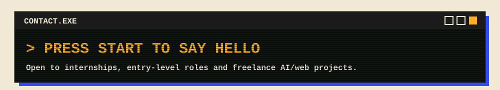

  <a href="https://www.linkedin.com/in/muhammad-bilal-khalid-a66676434">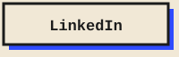</a>
  <a href="mailto:bilalkhalid8889@gmail.com">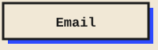</a>
  <a href="https://wa.me/923037825255">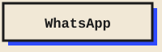</a>
  <a href="https://bilal-khalid.netlify.app/">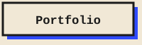</a>
  <a href="https://bilal-khalid.netlify.app/cv/Muhammad-Bilal-Khalid-CV.pdf">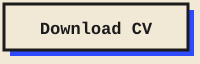</a>

bilalkhalid8889@gmail.com &nbsp;|&nbsp; +92 303 7825255 &nbsp;|&nbsp; Lahore, Pakistan

